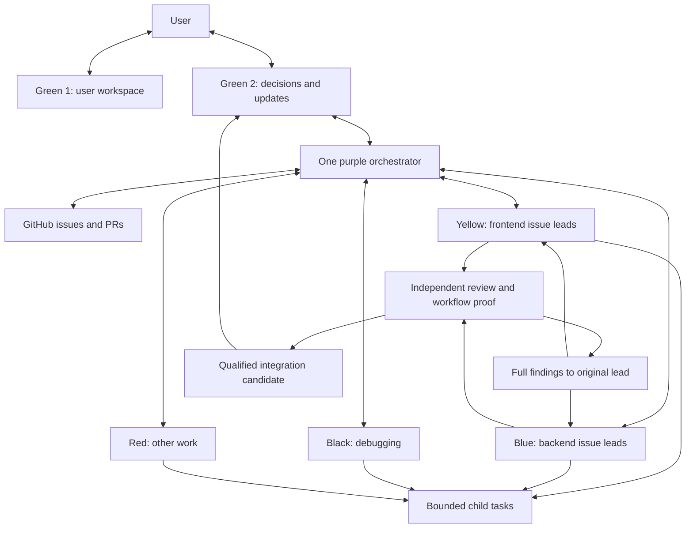

# Design and boundaries

SwarmStack is reusable process, not a universal application architecture. Project facts belong in the project's configuration and requirements.

## Operating map

Green 1 is the user's own workspace; agents do not message it. Green 2 batches required decisions and meaningful outcomes. Root coordinates dependencies/integration rather than implementing every issue. Other/debug work uses equivalent artifact-appropriate review.

## Eight requirements

1. Coloured numbered threads, actual issue numbers, one issue per dedicated lead.
2. Comparable Artificial Analysis model/effort evidence plus measured task cost, speed and reliability.
3. The operating map with explicit ownership, feedback, escalation and GitHub records.
4. Your customised skills, admitted for demonstrated value rather than novelty.
5. Short discovery metadata; task-triggered bodies and references, verified per host.
6. Practical checks derived from Matt Pocock's mistake list, without a growing global prompt.
7. ADHD-friendly output adapted to the user's preferences and task.
8. Portable core, host adapters, project configuration, versioned origins and compact evidence.

## Universal versus project-specific

| Core | Project configuration |
| --- | --- |
| One issue per lead; original lead fixes findings | Issue tracker, accepted scope and current owners |
| Separate source review and execution claims | Exact checks, runtime/platform and human acceptance |
| No implied spending or deployment | Model IDs, budgets and granted effects |
| Branch/workspace ownership | Branch names and authorised merge destinations |
| Concise decisions and outcomes | Language, channel and detail preferences |

No model name, subscription price or platform is a permanent universal default. Discovery should expose skill name/description, invocation loads SKILL.md, and relevant recipes load on demand. Host behavior varies and needs an adoption check. Submission/retrospective recipes load only at those boundaries.

Keep upstream origins and local changes. Extend existing owners before adding overlapping skills. Use avoided rework, elapsed time and context cost to decide value; do not build a metrics service just to optimise prompts.
